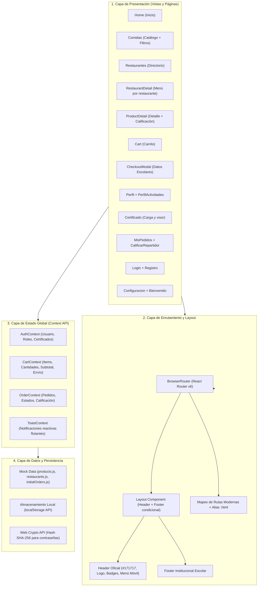
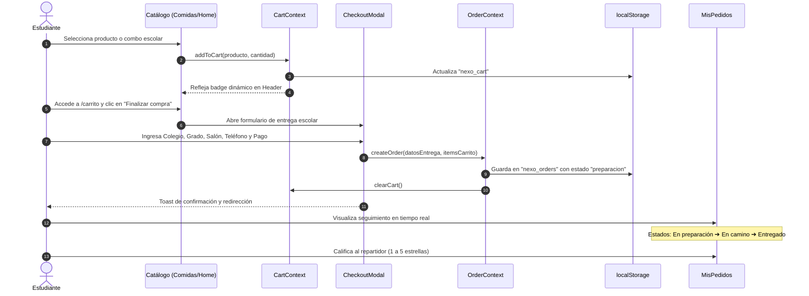

# 🎒 NEXO - Plataforma Estudiantil de Domicilios Escolares

**NEXO** es una plataforma web desarrollada para conectar restaurantes aliados con estudiantes de colegios en Colombia, permitiendo pedir comidas, combos y postres con entrega directa en la portería o descanso de su institución educativa.

Este proyecto ha sido completamente migrado de **HTML/CSS estático a una aplicación moderna en React con Vite**, conservando fielmente la identidad visual oficial (rojo `#e50914`, negro `#171717`, fondos `#f7f8fa`, tarjetas redondeadas con sombras suaves y el header exacto de NEXO).

---

## 🏛️ Arquitectura del Proyecto

La arquitectura de **NEXO Frontend** está diseñada bajo los principios de desacoplamiento, modularidad, persistencia local reactiva y compatibilidad hacia atrás con el sitio estático original.

### 1. Diagrama de Capas de la Aplicación



---

### 2. Diagrama de Flujo de Datos (Ciclo de Vida de un Pedido)



---

### 3. Descripción de las Capas

#### A. Capa de Presentación (`src/pages` y `src/components`)
- **Páginas (`src/pages/`):** Vistas completas asociadas a las diferentes rutas de navegación.
  - Vistas de catálogo y exploración (`Home`, `Comidas`, `Restaurantes`).
  - Vistas de detalle granular (`ProductDetail`, `RestaurantDetail`).
  - Vistas transaccionales (`Cart`, `CheckoutModal`).
  - Vistas de usuario y seguimiento (`Perfil`, `PerfilActividades`, `Certificado`, `MisPedidos`, `CalificarRepartidor`, `Configuracion`).
  - Vistas de acceso y bienvenida (`Login`, `Registro`, `Bienvenido`).
- **Componentes Reutilizables (`src/components/`):** Piezas de interfaz desacopladas como `Header`, `Footer`, `ProductCard`, `RestaurantCard`, `CheckoutModal` y el contenedor `Layout`.

#### B. Capa de Enrutamiento y Compatibilidad (`src/App.jsx`)
- Utiliza **React Router DOM v6**.
- Implementa una arquitectura de rutas dobles:
  1. **Rutas limpias modernas:** `/comidas`, `/restaurantes`, `/frisby`, `/carrito`, etc.
  2. **Alias legados (`.html`):** `/comidas.html`, `/Frisby.html`, `/cuarto libra.html`, `/carrito.html`, etc.
  Esto garantiza que cualquier marcador, enlace anterior o referencia estática siga funcionando sin romper la experiencia.
- Filtra la presentación del `Header` y `Footer` automáticamente en pantallas de autenticación (`/login`, `/registro`) y bienvenida (`/bienvenido`, `/portada`).

#### C. Capa de Estado Global (`src/context/`)
Implementada mediante el patrón **Provider Pattern** de React, evitando *prop drilling* y exponiendo hooks personalizados limpios:
- **`AuthContext` (`useAuth`):** Gestiona el usuario autenticado, datos de colegio/grado, carga/eliminación de certificado escolar y avatar.
- **`CartContext` (`useCart`):** Gestiona los productos agregados, sumatoria de cantidades, cálculo de subtotal, tarifa fija de domicilio ($3.000) y total formateado en pesos colombianos.
- **`OrderContext` (`useOrders`):** Administra los pedidos creados, estados de entrega escolar (`preparacion`, `enviado`, `entregado`) y calificaciones a los repartidores.
- **`ToastContext` (`useToast`):** Sistema centralizado de alertas flotantes animadas para retroalimentación al usuario.

#### D. Capa de Persistencia y Seguridad
- **`localStorage`:** Cada contexto sincroniza su estado automáticamente ante cualquier cambio (`nexo_user`, `nexo_cart`, `nexo_orders`).
- **Seguridad Criptográfica:** El módulo de autenticación implementa la API nativa del navegador `window.crypto.subtle` con algoritmos de hashing **SHA-256**, evitando almacenar credenciales en texto plano.

#### E. Capa de Datos Estructurados (`src/data/`)
- Contiene los modelos mock completos de restaurantes (`restaurants.js`), catálogo unificado de más de 35 productos con detalles e ingredientes (`products.js`) y pedidos iniciales de prueba (`initialOrders.js`).

---

## 🛠️ Estructura de Directorios

```
Nexo_fe_react/
├── public/                     # Iconos y recursos estáticos
├── html_referencia/            # Archivos HTML y CSS originales (conservados para auditoría)
├── src/
│   ├── assets/                 # Recursos gráficos adicionales
│   ├── components/             # Componentes modulares reutilizables
│   │   ├── Header.jsx          # Header oficial NEXO (#171717, logo, enlaces, badge, responsive)
│   │   ├── Header.css
│   │   ├── Footer.jsx          # Pie de página institucional estudiantil
│   │   ├── Footer.css
│   │   ├── Layout.jsx          # Envoltorio estructural de páginas
│   │   ├── ProductCard.jsx     # Tarjeta de comida reutilizable
│   │   ├── RestaurantCard.jsx  # Tarjeta de restaurante con valoración
│   │   └── CheckoutModal.jsx   # Modal de entrega con datos escolares
│   ├── context/                # Estado global y persistencia
│   │   ├── AuthContext.jsx     # Sesión escolar y seguridad SHA-256
│   │   ├── CartContext.jsx     # Carrito de compras y cálculo de montos
│   │   ├── OrderContext.jsx    # Ciclo de vida y tracking de pedidos
│   │   └── ToastContext.jsx    # Alertas y notificaciones interactivas
│   ├── data/                   # Datos simulados completos
│   │   ├── restaurants.js      # Aliados (McDonald's, Frisby, Subway, KFC, Pizza Hut, Santa Rosa)
│   │   ├── products.js         # Menú con más de 35 platos, precios y fotos
│   │   └── initialOrders.js    # Pedidos iniciales de demostración
│   ├── pages/                  # Vistas de la aplicación
│   │   ├── Home.jsx            # Inicio (Hero, Categorías, Destacados y Combos)
│   │   ├── Comidas.jsx         # Catálogo completo con buscador y filtros
│   │   ├── Restaurantes.jsx    # Directorio de restaurantes
│   │   ├── RestaurantDetail.jsx# Vista individual de cada restaurante
│   │   ├── ProductDetail.jsx   # Detalle de comida con estrellas y comentarios
│   │   ├── Cart.jsx            # Carrito con resumen de compra
│   │   ├── Perfil.jsx          # Perfil estudiantil editable y cambio de foto
│   │   ├── PerfilActividades.jsx # Historial de actividades escolares
│   │   ├── Certificado.jsx     # Subida, descarga y visor de certificado escolar
│   │   ├── MisPedidos.jsx      # Seguimiento de pedidos y estado de entrega
│   │   ├── CalificarRepartidor.jsx # Calificación interactiva al domiciliario
│   │   ├── Login.jsx           # Inicio de sesión escolar
│   │   ├── Registro.jsx        # Registro con validación y adjunto de certificado
│   │   ├── Configuracion.jsx   # Ajustes de notificaciones, idioma y cuenta
│   │   └── Bienvenido.jsx      # Pantalla de bienvenida / portada
│   ├── styles/                 # Hojas de estilo CSS que conservan el diseño original
│   │   ├── global.css          # Estilos globales y variables de color
│   │   ├── home.css            # Estilos del Inicio (Inicio.css)
│   │   ├── comidas.css         # Estilos del catálogo de comidas (Comidas.css)
│   │   ├── restaurantes.css    # Estilos del directorio de restaurantes
│   │   ├── restaurantDetail.css# Estilos de menús por restaurante
│   │   ├── productDetail.css   # Estilos de detalle de producto (hamburguesa.css)
│   │   ├── cart.css            # Estilos del carrito (carrito.css)
│   │   ├── perfil.css          # Estilos del perfil de usuario (perfil.css)
│   │   ├── certificado.css     # Estilos del certificado escolar (certificado.css)
│   │   ├── misPedidos.css      # Estilos de mis pedidos (mis_pedidos.css)
│   │   ├── calificarRepartidor.css # Estilos de calificación (Calificar_al_repartidor.css)
│   │   ├── auth.css            # Estilos de login y registro
│   │   └── configuracion.css   # Estilos de ajustes (Configuracion.css)
│   ├── App.jsx                 # Configuración de rutas y aliases legados
│   ├── index.css               # Reseteo base y fuentes
│   └── main.jsx                # Punto de entrada de React
├── eslint.config.js            # Configuración de ESLint
├── package.json                # Dependencias y scripts
└── vite.config.js              # Configuración de empaquetado Vite
```

---

## 🚀 Cómo Ejecutar el Proyecto

1. **Instalar dependencias:**
   ```bash
   npm install
   ```

2. **Iniciar servidor de desarrollo (Vite):**
   ```bash
   npm run dev
   ```
   Abre [http://localhost:5173](http://localhost:5173) en tu navegador.

3. **Compilar para producción:**
   ```bash
   npm run build
   ```

4. **Verificar linting y buenas prácticas:**
   ```bash
   npm run lint
   ```

---

## 🎨 Identidad Visual y Diseño Conservado

El proyecto preserva con absoluta exactitud la identidad visual oficial de NEXO:
- **Barra Superior (Header):** Fondo `#171717`, altura 75px, logo NEXO en `#e50914`, menú con enlaces a *Inicio*, *Comida*, *Restaurantes*, *Carrito*, *Perfil* y *Mis Pedidos*, estados activos, hover rojo y menú responsive adaptativo.
- **Paleta de Colores:**
  - Rojo Principal: `#e50914`
  - Negro / Oscuro: `#171717`, `#1f1f1f`
  - Fondos claros: `#f7f8fa`, `#ffffff`
  - Textos secundarios: `#666666`, `#888888`
- **Componentes Visuales:** Tarjetas redondeadas (`border-radius: 15px - 25px`), sombras suaves (`box-shadow`), tipografía legible y microinteracciones en botones y badges.

---

## 📋 Módulos y Funcionalidades Principales

### 1. Catálogo de Comidas y Restaurantes
- **Comidas:** Buscador en vivo, filtros por categorías (Hamburguesas, Pollo, Pizza, Mexicana, Sándwiches, Acompañamientos, Bebidas, Postres), ofertas destacadas y botones funcionales de compra y adición rápida.
- **Restaurantes Aliados:** Menú organizado por pestañas/secciones para **Frisby**, **McDonald's**, **Subway**, **KFC**, **Pizza Hut** y **Santa Rosa**.
- **Detalle de Producto:** Ingredientes detallados, selector de calificación por estrellas, caja de opiniones y acciones inmediatas de adición al carrito o compra directa.

### 2. Carrito de Compras y Checkout Escolar
- Control interactivo de cantidades (`+` y `−`) y eliminación unitaria.
- Cálculo automático de subtotal, costo fijo de envío escolar ($3.000) y total.
- Modal de checkout que solicita: Colegio, Grado, Salón, Teléfono del estudiante, Notas para entrega en portería y Método de pago.

### 3. Perfil, Actividades y Certificado Estudiantil
- **Perfil Estudiantil:** Edición en línea de información personal y actualización de fotografía de perfil.
- **Mis Actividades:** Historial completo de pedidos realizados con opción de eliminación o limpieza general.
- **Certificado de Estudio:** Carga de documento oficial, vista previa interactiva, descarga al computador/dispositivo y eliminación segura.

### 4. Seguimiento de Pedidos y Calificación
- **Mis Pedidos:** Indicadores de estado en tiempo real (*En preparación*, *En camino*, *Entregado*).
- **Calificar Repartidor:** Pantalla dedicada para valorar el servicio del domiciliario con puntuación de 1 a 5 estrellas y comentarios.

### 5. Autenticación y Seguridad
- Inicio de sesión y registro de estudiantes con validación en tiempo real.
- Cifrado seguro de contraseñas mediante **SHA-256** antes de su almacenamiento local.
- Cierre de sesión y protección de rutas.

---

## 🔒 Persistencia y Tecnologías Utilizadas

- **React 18** (Functional Components y Hooks modernos).
- **Vite 8** (Empaquetador ultrarrápido).
- **React Router DOM v6** (Enrutamiento declarativo y alias `.html`).
- **Context API + LocalStorage** (Persistencia sin requerir servidor backend externo).
- **Web Crypto API** (Hashing seguro SHA-256).
- **ESLint 9** (Código limpio y estandarizado).